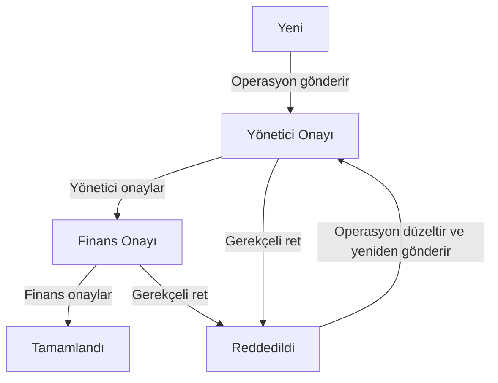

# FiloKontrol · Trafik Cezası Yönetim ve Onay Modülü

.NET 9 MVC, Entity Framework Core ve SQL Server ile geliştirilen araç ve trafik cezası yönetim uygulaması. Operasyon bir ceza kaydı oluşturur; yönetici ve finans sırayla onaylar. Her işlem kullanıcı, zaman, açıklama ve durum değişikliğiyle saklanır.

## Gereksinimler

- .NET **9 SDK** (`dotnet --list-sdks` ile kontrol edin; yalnızca Runtime yeterli değildir)
- Visual Studio 2022 17.12+ ve ASP.NET/web geliştirme iş yükü veya .NET CLI
- SQL Server Express LocalDB (Windows) ya da SQL Server 2022
- İlk kurulumda NuGet paketleri için internet bağlantısı

## Hızlı başlangıç (Windows / LocalDB)

1. ZIP'i çıkarın ve `TrafficFineManager.sln` dosyasını açın.
2. Terminali çözümün bulunduğu klasörde açın. `src` ve `tests` klasörlerini görmelisiniz.
3. Aşağıdaki komutları sırayla çalıştırın:

```powershell
dotnet --list-sdks
sqllocaldb start MSSQLLocalDB
dotnet restore
dotnet user-secrets set "Demo:Password" "FiloDemo!2026" --project src/TrafficFineManager.Web
dotnet dev-certs https --trust
dotnet run --project src/TrafficFineManager.Web
```

Tarayıcıda **https://localhost:7180** adresini açın. Visual Studio ile çalıştırmak için Web projesini başlangıç projesi yapıp `TrafficFineManager` profilini seçin ve F5'e basın.

`Demo:Password` komutunda örnek şifre yerine kendi güçlü şifrenizi seçebilirsiniz. Şifre kaynak dosyalarda saklanmaz. İlk çalıştırmada belirlenir; daha sonra user-secrets değerini değiştirmek mevcut kullanıcıların şifrelerini değiştirmez.

Geliştirme modunda ilk açılışta veritabanı, roller, üç kullanıcı, dört araç ve farklı aşamalarda beş örnek ceza hazırlanır. Tekrar başlatmak aynı verileri yeniden eklemez. Örneklerin tamamı kurgusaldır.

| Rol | E-posta | Yetki |
| --- | --- | --- |
| Operasyon | operasyon@demo.local | Araç ekler, ceza oluşturur; kendi yeni/reddedilmiş cezasını düzenler ve onaya gönderir |
| Yönetici | yonetici@demo.local | Yönetici aşamasındaki cezayı onaylar veya gerekçeli reddeder |
| Finans | finans@demo.local | Finans aşamasındaki cezayı onaylar veya gerekçeli reddeder |

Üç hesabın ilk şifresi user-secrets ile belirlediğiniz `Demo:Password` değeridir. Tüm roller listeleri, detayları ve geçmişi okuyabilir. Kayıt/rol yönetim ekranı bu case kapsamına dahil değildir.

## SQL Server bağlantısı

Varsayılan bağlantı `appsettings.json` içinde Windows LocalDB içindir. SSMS'te kullandığınız farklı bir sunucu için kaynak dosyaya şifre yazmadan bağlantıyı değiştirin:

```powershell
dotnet user-secrets set "ConnectionStrings:DefaultConnection" "Server=localhost;Database=TrafficFineManager;Trusted_Connection=True;TrustServerCertificate=True" --project src/TrafficFineManager.Web
```

SQL kullanıcı adı/şifre ile bağlanıyorsanız `Trusted_Connection` yerine uygun `User Id` ve `Password` değerlerini yalnızca user-secrets veya ortam değişkeninde saklayın. SQL Server'ın çalıştığından ve hesabın veritabanı oluşturabildiğinden emin olun.

## İş akışı ve kurallar



- Yeni ceza taslak olarak kaydedilir. Oluşturmak ile onaya göndermek ayrı işlemlerdir.
- Reddedilen kayıt düzenlenebilir; tekrar gönderildiğinde yönetici aşamasından başlar. Önceki ret gerekçesi geçmişte kalır.
- Onay bekleyen ve tamamlanan kayıtlar değiştirilemez. Silme işlemi yoktur.
- Tamamlandı, onay sürecinin tamamlandığını ifade eder; ödeme kaydı veya ödeme entegrasyonu içermez.
- Ret nedeni boş veya yalnızca boşluk olamaz. Açıklamalar 1000 karakterle sınırlıdır.
- İhlal tarihi gelecekte olamaz; tutar pozitif ve en fazla iki ondalıklı olmalıdır.
- Plakalar boşluk/tire çıkarılıp büyük harfe çevrilerek tekilleştirilir. Yabancı plakalar desteklenir; ülkeye özel regex kullanılmaz.
- Tutanak numarası trim + büyük harf ile normalize edilir ve benzersizdir.
- Tarih/saat UTC saklanır; işlem geçmişi Türkiye saatinde görüntülenir.
- Aynı kayda çift tıklama veya eş zamanlı karar durumunda `Version` concurrency token eski işlemi reddeder.

## Mimari

```text
src/TrafficFineManager.Web/
  Controllers/   HTTP, doğrulama, yönlendirme, rol bazlı erişim
  Services/      FineWorkflowService: geçiş, sahiplik ve iş kuralları
  Data/          EF Core context, Identity ve geliştirme seed'i
  Models/        Araç, ceza, onay geçmişi ve enum'lar
  ViewModels/    Kullanıcı girdileri; entity'lere doğrudan model binding yapılmaz
  Views/         Razor MVC ekranları
  wwwroot/      Yerel CSS/JavaScript; CDN bağımlılığı yok

tests/TrafficFineManager.Tests/
  WorkflowTests.cs  SQLite ilişkisel veritabanıyla iş akışı testleri
```

EF Core DbContext unit-of-work davranışını zaten sağlar; case ölçeğinde ek generic repository veya mikroservis katmanı kullanılmadı. İş kuralları controller'dan ayrılmış tek bir serviste toplanır. Durum değişikliği ile geçmiş aynı `SaveChangesAsync` içinde atomik olarak yazılır. Durumlar veritabanında integer enum olarak saklanır; enum değerleri sonradan yeniden sıralanmamalıdır.

## Güvenlik ve hata yönetimi

ASP.NET Core Identity şifre hash'leme ve cookie oturumunu yönetir. Beş hatalı girişten sonra beş dakika kilitleme uygulanır. Rol denetimi hem controller hem işlem servisinde yapılır. Tüm POST işlemlerinde antiforgery token doğrulanır. Razor metinleri otomatik encode eder. Dış adrese login yönlendirmesi yapılmaz. Üretim hataları kullanıcıya stack trace göstermez. Plaka ve tutanak benzersizliği veritabanı index'i ile de korunur. Demo kullanıcıları sadece Development ve `Demo:Enabled=true` iken oluşturulur.

## Testler

```powershell
dotnet build TrafficFineManager.sln --configuration Release
dotnet test TrafficFineManager.sln --configuration Release
```

SQLite testler için kullanılır; uygulamanın çalışma veritabanı SQL Server'dır. İlişkisel testler doğru/yanlış rol, ret gerekçesi, düzenleme sahipliği, tam onay akışı, yeniden gönderim, tutar/tarih doğrulaması, mükerrer kayıt ve iki DbContext ile concurrency senaryolarını kapsar. SQL Server kurulumunu ayrıca yerelde doğrulamak gerekir. Ayrıntılı kabul senaryosu `docs/KABUL-TESTI.md` dosyasındadır.

## Şema yönetimi / kapsam sınırları

Bu case ilk kurulumda geliştirme veritabanını `EnsureCreatedAsync` ile oluşturur. Migration geçmişi içermez; mevcut bir şemayı otomatik değiştirmez. Şema değişirse örnek geliştirme veritabanını yedekledikten sonra yeni bir veritabanı adı kullanın. Üretim ortamına geçmeden önce başlangıç migration'ı, kontrollü deployment, ayrı kullanıcı yönetimi ve güvenli provisioning gerekir. Production'da otomatik seed/şema oluşturma çalışmaz. `EnsureCreated` ile migration aynı veritabanında karıştırılmamalıdır.

Ceza listesi 15 kayıtlık sayfalama ve durum/plaka/tutanak filtreleri içerir. Araç listesi en fazla 200 sonucu gösterir ve aramayı destekler. Dosya yükleme, e-posta, ödeme ve harici servis entegrasyonu bu case kapsamı dışında bırakılmıştır.

## Teslim

Repository'de şifre, `bin/obj`, veritabanı dosyası veya kişisel erişim anahtarı bulunmamalıdır. Git paylaşım adımları ve Live Session hazırlığı `docs/TESLIM-VE-SUNUM.md` dosyasındadır. Doğrulanan kontrollerin kaydı `docs/DOGRULAMA.md` içinde tutulur.
